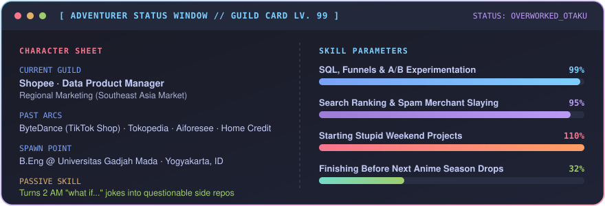

 

  <strong>いらっしゃいませ!</strong> I'm <strong>Ilham</strong> — a <strong>Data Product Manager at Shopee</strong> handling <strong>Regional Marketing across Southeast Asia</strong> when the sun is up, and a chronic weeb who builds gloriously stupid, over-engineered side quests on my free time once everyone else is asleep.

---

### 🎬 Anime Season Arcs (My Lore, Zero LinkedIn Speak)

| Season | Guild / Arc | What Actually Happened |
| :--- | :--- | :--- |
| **Season 5** *(Currently Airing)* | 🧡 **Shopee** · *Data Product Manager* | Handling **Regional Marketing across the Southeast Asia market**. Turning massive regional promo chaos, experiments, and growth funnels into actual product wins. |
| **Season 4** | 🎵 **ByteDance (TikTok Shop)** · *Global E-Commerce Data Scientist* | Lived inside SEA Search Ranking & Front End. Redefined search sessions (+~1% CVR), tuned Add-To-Cart ranking signals (+2.62% GMV / +1.77% AOV), matched search keywords with coupons (+1.91% GMV/user), and unified trackers & metrics across TikTok Shop × Tokopedia. |
| **Season 3** | 💚 **Tokopedia** · *Data Analyst* | Taught search ranking to care about shipping speed, price, and quality (+$5.3M/yr sales), banished spam listings to the Shadow Realm (+0.79% CVR, -$696K/yr cost), busted fake discounts (+$3.2M/yr), and wired self-serve dashboards & A/B testing pipelines. |
| **Season 2** | 🧠 **Aiforesee** · *Data Scientist* | Built procurement vendor ratings (~+15% order CVR) and boosted credit scoring models (+7% AUC-ROC) using alternative data (telco, mining, logistics). |
| **Season 1** *(Origin Arc)* | 🏦 **Home Credit** + 🎓 **UGM Yogyakarta** | Automated e-commerce loan flows (-8.3% manual toil) right after wrapping a **B.Eng at Universitas Gadjah Mada**. |

---

### 🎮 Weekend Chaos & Public Side Quests

When I'm not staring at SEA marketing funnels or arguing with dashboards, I'm usually whispering *"wait, wouldn't it be funny if I built..."* at 1 AM and spawning way too many TypeScript/Python experiments.

Old-school ML / notebook relics still hanging out in public:

- 📊 [`Home-Credit-Default-Risk`](https://github.com/ilhamzul/Home-Credit-Default-Risk) — Vintage Kaggle default-risk modeling arc
- 💸 [`Lending-Club`](https://github.com/ilhamzul/Lending-Club) — Early loan-risk & feature engineering experiments
- 👥 [`Employee-termination-prediction`](https://github.com/ilhamzul/Employee-termination-prediction) — HR churn prediction notebook
- 🌐 [`ilhamzul.github.io`](https://github.com/ilhamzul/ilhamzul.github.io) — Dusty web corner from a simpler time

*(Half my recent dumb-but-actually-working builds live in private labs until they graduate from "why did I make this" to public.)*

---

### 🪄 Tech Grimoire (Spells & Tools)

---

### 🏮 Summon Me (Or Just Say Yo)

 

