 

  <strong>你好!</strong> I'm <strong>Ilham</strong> — a <strong>Data Product Manager at Shopee</strong> steering <strong>Regional Marketing across Southeast Asia</strong> by day, and a serial AI-era builder cooking up my own pre-launch studio <strong>Ventubox</strong> after hours.

---

### 🏮 Building in Stealth: **Ventubox**

**Ventubox** *(pre-launch)* is my upcoming **umbrella product studio** where I turn slightly unhinged *"why doesn't this exist properly yet?"* ideas into real AI-powered apps:

| Project | What It Does | Why I Built It |
| :--- | :--- | :--- |
| 📄 **Auto CV Tailor** | Reads a target job post, matches it against your actual background, and automatically generates & edits a tailored CV to fit. | Zero manual formatting pain—match real signal to the role cleanly. |
| 🀄 **Hanzi Flashcards** | A full Chinese flashcard & learner's dictionary engineered with strict 1:1 pinyin alignment, real SRS memory science, handwriting/strokes, and honest examples. | Built to help people **actually learn Chinese better than Duolingo**. |
| 🧩 **Kids Everyday Play** | Fun, interactive mini-games and learning tools designed around real objects & situations kids find in everyday life. | Training curiosity and real-world thinking without mind-numbing slop. |

*(Everything under Ventubox shares unified auth, design tokens, and AI pipelines while keeping each product fast and focused.)*

---

### ⚔️ Cultivation Arcs *(Zero LinkedIn Corporate Speak)*

| Arc | Sect / Company | Story Summary |
| :--- | :--- | :--- |
| **Current Arc** | 🧡 **Shopee** · *Data Product Manager* + 🏮 **Ventubox** | Running data product for **Regional Marketing across the SEA market** at Shopee while forging multiple AI products under **Ventubox** at night. |
| **Arc IV** | 🎵 **ByteDance (TikTok Shop)** · *Global E-Commerce Data Scientist* | Built SEA Search Ranking & Front End wins: redefined search sessions (`+~1% CVR`), tuned Add-To-Cart ranking (`+2.62% GMV`, `+1.77% AOV`), matched search keywords to coupons (`+1.91% GMV/user`), and unified metrics & trackers across TikTok Shop × Tokopedia. |
| **Arc III** | 💚 **Tokopedia** · *Data Analyst* | Reranked search for delivery speed & product quality (`+$5.3M/yr` sales), exorcised spam merchants (`+0.79% CVR`, `-$696K/yr` infra cost), nerfed fake discounts (`+$3.2M/yr`), and built self-serve A/B & BI pipelines. |
| **Arc II** | 🧠 **Aiforesee** · *Data Scientist* | Engineered procurement vendor ratings (`~+15%` order conversion) and upgraded generic loan scoring with alt-data across telco, mining & logistics (`+7% AUC-ROC`). |
| **Arc I *(Origin)*** | 🏦 **Home Credit** + 🎓 **UGM Yogyakarta** | Automated e-commerce loan integration workflows (`-8.3%` manual grind) after earning a **B.Eng at Universitas Gadjah Mada**. |

---

### 🧪 Public Sandbox & Early Scrolls

Old-school ML / notebook relics sitting in public while the newer **Ventubox** apps are cooking in private:

- 📊 [`Home-Credit-Default-Risk`](https://github.com/ilhamzul/Home-Credit-Default-Risk) — Vintage Kaggle default-risk modeling arc
- 💸 [`Lending-Club`](https://github.com/ilhamzul/Lending-Club) — Early credit scoring & feature engineering notebooks
- 👥 [`Employee-termination-prediction`](https://github.com/ilhamzul/Employee-termination-prediction) — HR churn prediction experiment
- 🌐 [`ilhamzul.github.io`](https://github.com/ilhamzul/ilhamzul.github.io) — First web outpost

---

### ⚡ Tech & AI Arsenal

---

### 🏮 Connect

 

